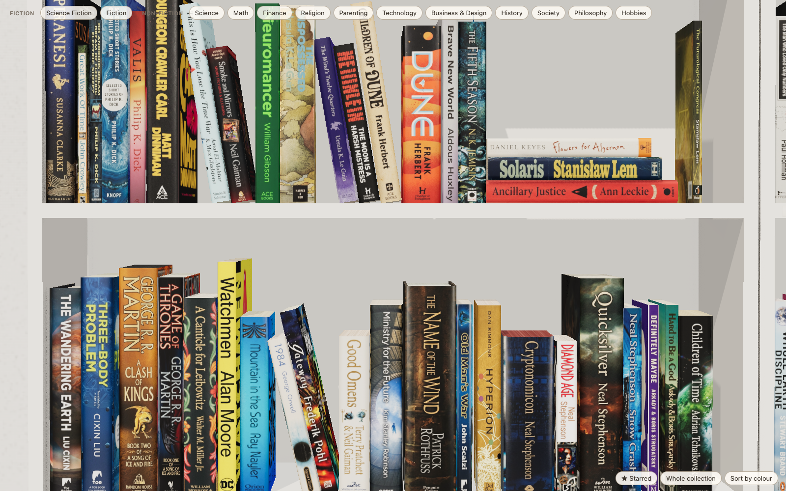

# bookshelf

A photoreal, interactive 3D bookshelf of the books I've read, built as a prototype for [smus.com/books](https://smus.com/books/).

Two white IKEA Billy bookcases (Fiction and Non-fiction) on a cream carpet. Every book has its real dimensions, a
spine, front cover and back cover, and sits on the shelf the way books actually do: some leaning, some stacked,
section labels from a label maker. Click a book and it flies off the shelf into a card with my review.



## Run it

```sh
cd poc && python3 -m http.server 8791
open http://127.0.0.1:8791/preview/
```

Drag (or two-finger scroll) to pan, pinch to zoom, click a book. `★ Starred`, `Whole collection` and the
`Sort by colour` joke are in the bottom-right.

## How it's made

| Step | Script | Notes |
| --- | --- | --- |
| Books | `build_books.py`, `import_goodreads.py` | smus.com reviews are the source of truth; Goodreads "read" books fill in the rest |
| Metadata | `enrich.py`, `fix_matches.py`, `gbooks_dims.py`, `refine_dims.py` | Open Library + Google Books for ISBNs and real dimensions; width always matches the cover's proportions |
| Covers | `fetch_covers.py`, `split_jackets.py` | smus.com covers, Open Library otherwise; full dust-jacket scans are split into back / spine / front |
| Spines | `gen_spines.py`, `upscale_spines.py` | generated from the front cover with Gemini (`gemini-3.1-flash-image`); every result is auto-checked for proportions and cropping, and retried |
| Back covers | `gen_backs.py` | artwork-only (no invented text), from the front cover |
| Layout | `build_shelf.py` | sections from `data/sections.yaml`, sorted by author; sections never wrap across shelves; flat stacks and leaning runs use each shelf's slack |
| Render | `preview/index.html` | Three.js: one texture + one mesh per book, rounded spines, ambient occlusion, soft shadows |

Hand fixes live in `data/overrides.json` (editions, titles, dimensions) and `data/exclude.json` (courses, kids'
books, textbooks kept off the shelf).

Regenerating images needs `GEMINI_API_KEY` (and optionally `GOOGLE_BOOKS_API_KEY`) in `.env`.

## Status

Prototype. Next: integrate with smus.com.
